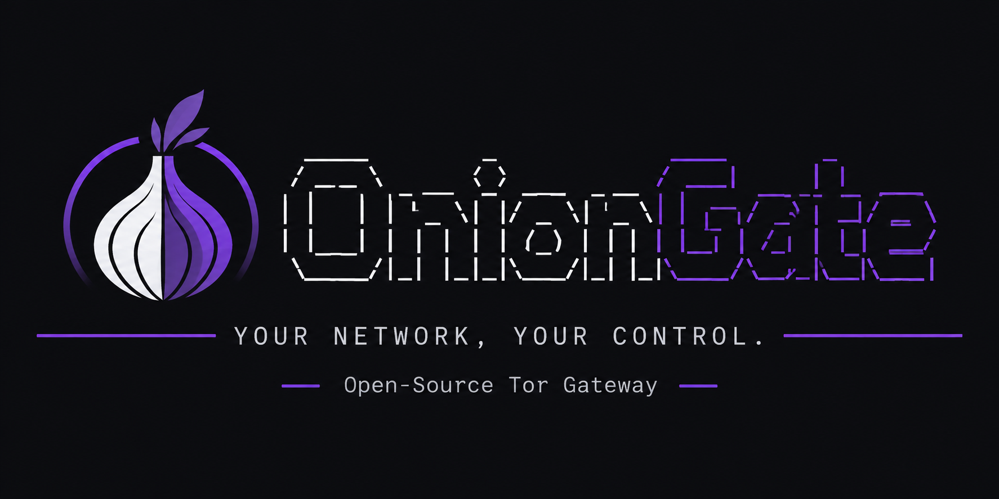

# OnionGate



**An open-source Tor gateway for Linux.**

OnionGate is an independent project and is not official Tor Project software.
It provides a command-line interface for the existing Bash gateway backend
and an optional PySide6 desktop GUI for status, diagnostics, and user-confirmed
connection controls.

[GitHub Profile](https://github.com/usamoo2025) •
[Repository](https://github.com/usamoo2025/oniongate) •
[Report an Issue](https://github.com/usamoo2025/oniongate/issues)


## About OnionGate

OnionGate is an independent open-source Linux project.
It aims to provide a Tor-based gateway for supported Debian- and Arch-family
distributions through a Bash backend and command-line interface. The backend
provides direct Tor mode and optional obfs4, Snowflake, and meek_lite bridge
modes, with commands to start, stop, and inspect OnionGate.

The optional PySide6 desktop application works alongside the existing CLI; it
does not replace or reimplement the gateway. After an explicit user action and
confirmation, the GUI can ask the existing CLI to start or stop OnionGate
through `pkexec`. The Bash backend remains responsible for Tor, firewall, and
DNS behavior. OnionGate is not official Tor Project software and is not
affiliated with the Tor Project.

## Features

- Bash CLI for the gateway backend and its existing start, stop, status,
  version, help, and uninstall commands.
- Debian- and Arch-family package-manager detection in the installer.
- Optional dark/light PySide6 interface with Dashboard, Locations,
  Connection, Bridges, Diagnostics, Settings, and About pages.
- Read-only checks for distribution, CLI, Tor, configuration, logs, status,
  required utilities, and optional bridge transport binaries.
- Existing CLI bridge modes: direct, obfs4 (`-o`), Snowflake (`-s`), and
  meek_lite (`-m`).
- Optional Tor country exit preference via `--country CODE`. Relay availability
  and observed exit country are not currently queried.

Configure supported bridge transports and inspect your installation through
the CLI or GUI. A selected country is only Tor's `ExitNodes` preference; it
does not guarantee an exit in that country. No systemd dependency is assumed
by the GUI.

## Supported distribution targets

The installer and diagnostics target Debian-based distributions (including
Debian, Ubuntu, Kali, Linux Mint, and Pop!_OS) and Arch-based distributions
(including Arch Linux, Manjaro, and EndeavourOS). **These targets have not
been verified on live Debian or Arch systems as part of this development
work.** Package availability and runtime behavior can vary.

## Requirements

### Gateway backend

- Bash and a supported Debian- or Arch-family Linux distribution.
- Tor, curl, iproute2, iptables, ca-certificates, util-linux, and other
  utilities checked by the backend.
- Root privileges when installing or running gateway-changing CLI commands.
- A compatible bridge transport and bridge configuration when using a bridge.

### Desktop GUI

- Python 3 and PySide6.
- The installed OnionGate CLI.
- `pkexec` is needed for GUI start/stop controls. If it is unavailable, the GUI
  leaves those controls disabled and directs you to the manual CLI commands.
- Administrative commands are never launched automatically.

## Installation

Clone the project and enter its directory:

```bash
git clone https://github.com/usamoo2025/oniongate.git
cd oniongate
```

Make the installer executable if necessary:

```bash
chmod +x install.sh
```

Install the CLI/backend:

```bash
sudo ./install.sh
```

The installer detects the distribution family and uses its package manager.
Existing `/etc/oniongate/oniongate.conf` is preserved on upgrade. The
installer reports success only after required installation checks pass.

Install the optional GUI and desktop launcher as well:

```bash
sudo ./install.sh --with-gui
```

This installs Python GUI dependencies in `/opt/oniongate/venv`, adds the
`oniongate-gui` launcher, and installs a desktop entry. PySide6 installation
requires access to the configured Python package index. Without
`--with-gui`, the CLI installation is unchanged.

Check the CLI:

```bash
oniongate version
oniongate help
```

The installer installs the command at `/usr/local/bin/oniongate`. Check that
your shell can find it with:

```bash
command -v oniongate
```

### Install GUI dependencies manually

If you prefer to install the GUI dependencies yourself rather than use
`--with-gui`, install Python and virtual-environment support using your
distribution's package manager:

Debian-based systems:

```bash
sudo apt update
sudo apt install python3 python3-venv python3-pip
```

Arch-based systems:

```bash
sudo pacman -S python python-pip
```

Then follow the development setup below to create a virtual environment and
install PySide6. Manual installation does not add a system desktop launcher.

Launch the installed GUI as your normal desktop user:

```bash
oniongate-gui
```

## About the GUI

The desktop application is a PySide6 companion to the Bash CLI, not a second
gateway implementation. Start and stop actions require a button click, a
confirmation, and `pkexec`; the GUI does not run `sudo` or directly edit
firewall, routing, or system configuration.

The sidebar contains seven pages:

- **Dashboard:** Shows installation and dependency state, actual CLI-reported
  runtime status, selected exit preference, and a connection control.
- **Locations:** Offers Automatic and common country preferences. Availability
  is explicitly shown as not queried; a preference is not a relay guarantee.
- **Connection:** Starts/stops the existing CLI backend and reports verified
  Tor connectivity, reported exit IP, observed country availability, and
  session duration. Duration is only tracked for the current GUI session.
- **Bridges:** Shows direct, obfs4, Snowflake, and meek_lite modes and checks
  local transport/configuration availability before enabling a connection.
- **Diagnostics:** Lists the detected Linux distribution and package
  managers, CLI/version/help/status checks, Tor and optional bridge
  transport executables, required system utilities, and accessibility of
  configuration, status, and log files. Use **Refresh checks** to run them
  again.
- **Settings:** Saves user-scoped theme, default location/bridge, and log
  display preferences. It does not silently rewrite `/etc/oniongate/`.
- **About:** Identifies OnionGate as an independent project that is not
  official Tor Project software.

The GUI communicates with the installed CLI using its existing commands and
the optional `--country` preference. It shows Connected only after the CLI
reports ACTIVE and a successful Tor connectivity check. Relay availability,
observed exit country, and bootstrap percentages are not fabricated; they are
shown only when the backend provides evidence.

## Development setup

Create and activate a virtual environment from the repository root:

```bash
python3 -m venv .venv
source .venv/bin/activate
python -m pip install PySide6
python gui/app.py
```

The GUI checks standard installation paths and `PATH` for the backend. It
does not need root to open or run checks. If Python reports that PySide6 is
missing, confirm that the virtual environment is active and install it in
that environment:

```bash
python -m pip install PySide6
```

Run unit tests and a syntax check from the repository root:

```bash
python -m compileall gui
python -m unittest discover -s tests -v
```

The GUI smoke test uses Qt's offscreen platform when no desktop is available.

## GUI screenshots

Screenshots will be added after the interface is run and captured on a
supported Linux desktop.

## CLI quick reference

```bash
sudo oniongate start             # Start in direct mode
sudo oniongate start -o          # Start with obfs4
sudo oniongate start -s          # Start with Snowflake
sudo oniongate start -m          # Start with meek_lite
sudo oniongate start --country de # Prefer German exits
sudo oniongate start -o --country nl
sudo oniongate start -v          # Start with verbose Tor output
sudo oniongate start --spoof-mac # Explicitly opt in to MAC changes
sudo oniongate status
sudo oniongate stop
oniongate version
oniongate help
```

`--country` sets Tor's ExitNodes preference and does not ensure a usable exit
exists there; Tor may use another country if necessary. Bridge lines are
configured explicitly in `/etc/oniongate/oniongate.conf`.

## Paths

| Purpose | Path |
|---|---|
| Configuration and application data | `/etc/oniongate/` |
| Bridge configuration | `/etc/oniongate/oniongate.conf` |
| Generated Tor configuration | `/etc/oniongate/torrc` |
| Runtime status file | `/etc/oniongate/oniongate.status` |
| Tor log | `/etc/oniongate/tor.log` |
| GUI virtual environment (installed) | `/opt/oniongate/venv/` |

## How OnionGate Works

When you start OnionGate from the CLI, the Bash backend performs these
operations:

1. Checks root privileges and identifies the supported Linux distribution.
2. Checks for required utilities and the Tor service account.
3. Reads the selected bridge lines from `/etc/oniongate/oniongate.conf` when
   a bridge mode is requested.
4. Prepares OnionGate's private Tor configuration, including an optional
   country exit preference, and validates it before applying firewall rules.
5. Creates or updates its own firewall chains for supported traffic.
6. Starts the Tor process managed by OnionGate.
7. Checks Tor connectivity and records the runtime status.

Starting the gateway changes firewall state and can affect network
connectivity. Use the CLI only when you understand these effects. GUI
connection actions invoke the same CLI after explicit confirmation; they do
not implement a separate networking engine.

When stopped, the CLI stops the Tor process it started, removes its
OnionGate-owned rules, and clears its runtime status. Do not assume this
covers traffic from every application or protocol.

## Firewall and Traffic Handling

The backend uses dedicated firewall chains:

```text
ONIONGATE_NAT
ONIONGATE_OUT
ONIONGATE6_OUT
```

These chains are intended to keep OnionGate's rules separate from unrelated
firewall rules. The backend uses them for DNS redirection, supported TCP
traffic, and restrictions on unsupported outbound traffic. Inspect the
backend and your system's firewall configuration before use.

### Traffic limitations

- Not every UDP application is supported through Tor.
- Private and local destinations may bypass Tor.
- Applications using their own encrypted DNS may not follow system DNS
  redirection.
- Other VPN software or custom routing rules may conflict with OnionGate.
- A successful Tor connection does not prove every application is using Tor.

Always verify application network behavior rather than assuming that starting
OnionGate protects every connection.

## Diagnostics and limitations

The GUI runs CLI status and diagnostics with timeouts and reads the real
configuration/status/log paths. Start and stop use the installed CLI through
`pkexec` only after a user action and confirmation. A timeout or unrecognized
status is shown as unknown, not as a fabricated connection state.

OnionGate does not guarantee complete anonymity or route all protocols
through Tor. UDP traffic, private/local destinations, applications using
independent encrypted DNS, VPNs, or other network paths may not be covered.
Firewall and network configuration changes are performed by the existing
privileged CLI backend, not by separate Python networking code. Review the
backend behavior and network risks before use.

## Security Considerations

OnionGate is a network configuration tool, not a substitute for good
security practices:

- Tor does not make users completely anonymous.
- Avoid sharing personal information with untrusted services.
- HTTPS remains important when browsing websites.
- Do not assume every application automatically uses Tor.
- Keep Tor and your operating system updated.
- Review firewall and DNS behavior after installation.
- Test network changes in an environment where you can recover connectivity.

The CLI makes privileged firewall and network changes when you start the
gateway. Incorrect configuration or conflicts with other network tools can
interrupt connectivity. GUI actions invoke the backend only after explicit
confirmation. Never blindly flush the system firewall to troubleshoot
OnionGate; that could remove rules belonging to other applications.

## Troubleshooting

### OnionGate command not found

Check whether the CLI is on your `PATH`:

```bash
command -v oniongate
```

If it is missing, check the backend installation.

### GUI cannot find the backend

Check both the CLI and (for an installed GUI) launcher:

```bash
command -v oniongate
command -v oniongate-gui
```

The GUI needs the installed CLI for version, help, and status information.

### PySide6 module not found

For development, activate the virtual environment and install PySide6 into
that environment:

```bash
source .venv/bin/activate
python -m pip install PySide6
```

For the system installation, rerun the installer with `--with-gui`.

### GUI does not start

Run it from a terminal to see Python or Qt errors:

```bash
oniongate-gui
```

Or, from the project checkout:

```bash
python gui/oniongate_gui.py
```

### Runtime status is unknown

Check the CLI output:

```bash
sudo oniongate status
```

The backend's status command may check Tor connectivity when OnionGate is
active. If the command times out or returns unexpected output, the GUI
reports the runtime as unknown rather than assuming a connection state.

### Check installed dependencies

```bash
command -v tor
command -v curl
command -v ip
command -v iptables
```

The GUI Diagnostics page also lists required utilities, distribution details,
and optional bridge transport binaries.

### Check OnionGate logs

```bash
sudo tail -n 50 /etc/oniongate/tor.log
```

The log may not exist or be readable when OnionGate has not been started.

### Network connectivity problems

1. Check OnionGate status and review its log.
2. Check whether another VPN or firewall is managing network traffic.
3. Stop OnionGate using its normal CLI command:

   ```bash
   sudo oniongate stop
   ```

4. Review the system firewall configuration before making other changes.

Do not blindly flush firewall rules; this may remove rules belonging to other
applications.

## Uninstallation

Run the installed backend uninstaller:

```bash
sudo oniongate uninstall
```

It removes OnionGate application and GUI files but preserves
`/etc/oniongate/`, including configuration and data. Dependencies such as Tor
are not removed. Review and remove the preserved directory manually only if
you explicitly intend to delete that data.

## Reporting Issues

If you encounter a problem, [open an issue](https://github.com/usamoo2025/oniongate/issues).
Include the Linux distribution and version, OnionGate version, whether the
issue occurs in the CLI or GUI, relevant error output, and steps to reproduce.

Do not include passwords, private keys, personal information, or sensitive
bridge configuration in issue reports.

## Author and Project

- **Project:** OnionGate
- **Maintainer:** Usama Iqbal
- **GitHub:** [usamoo2025](https://github.com/usamoo2025)
- **Repository:** [usamoo2025/oniongate](https://github.com/usamoo2025/oniongate)

## License and contributions

OnionGate is intended to be distributed under the GNU General Public License
v3.0 (GPL-3.0). See [LICENSE](LICENSE) for the complete license text.

Contributions and distribution-specific test reports are welcome. Please
include which distribution and version you used when reporting compatibility.
